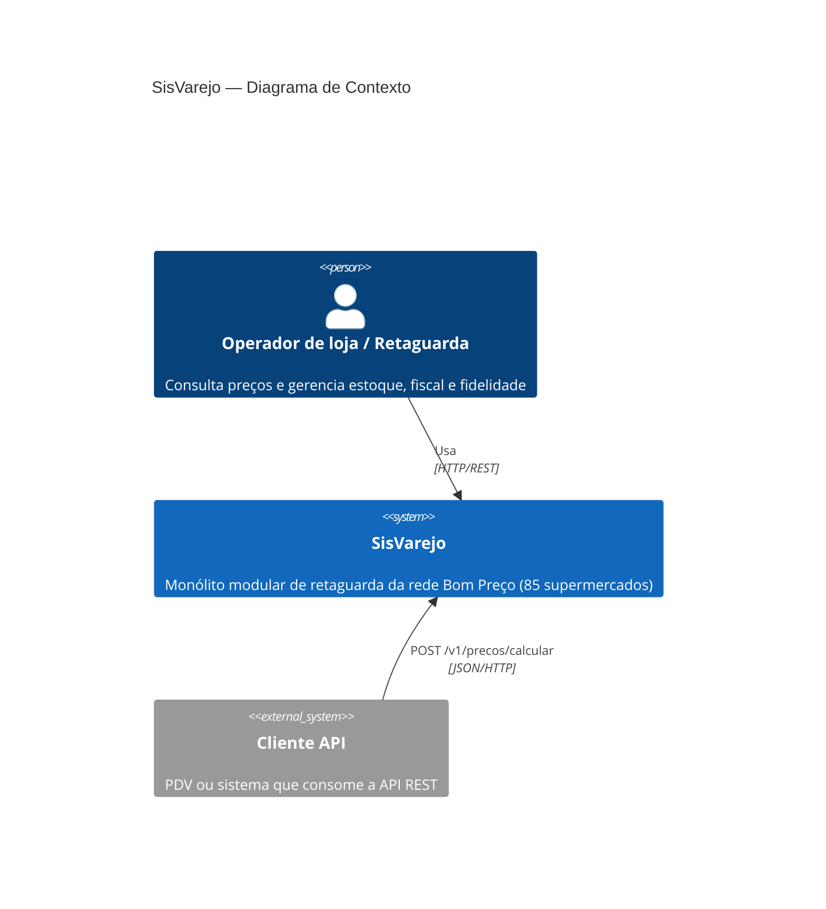
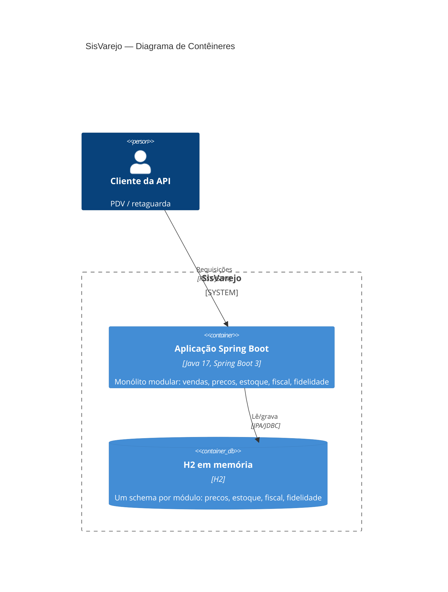
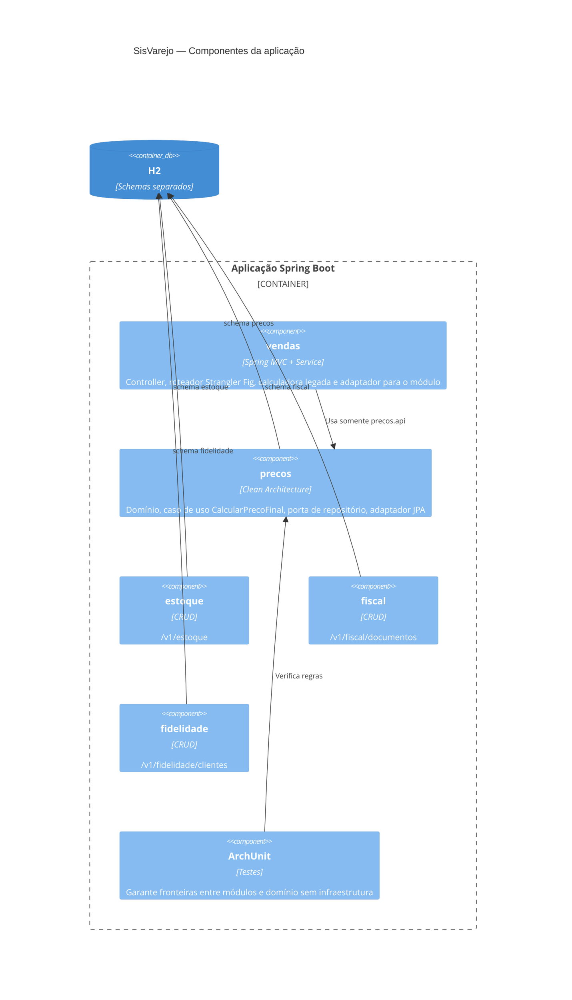
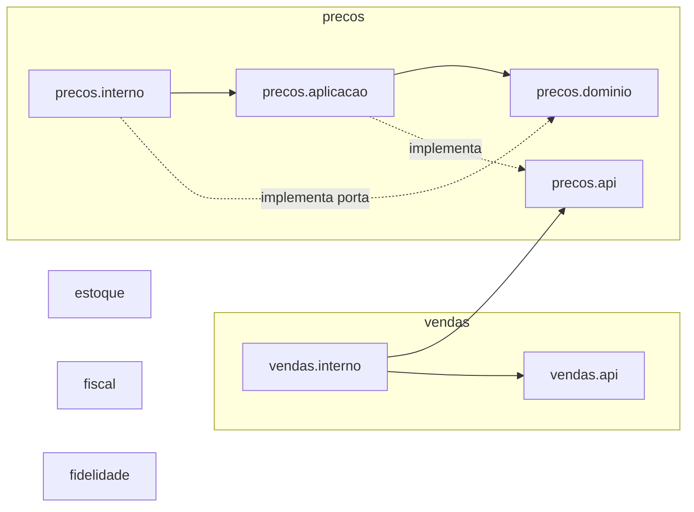
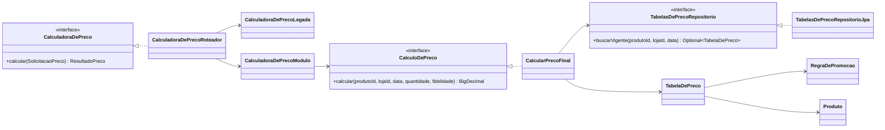
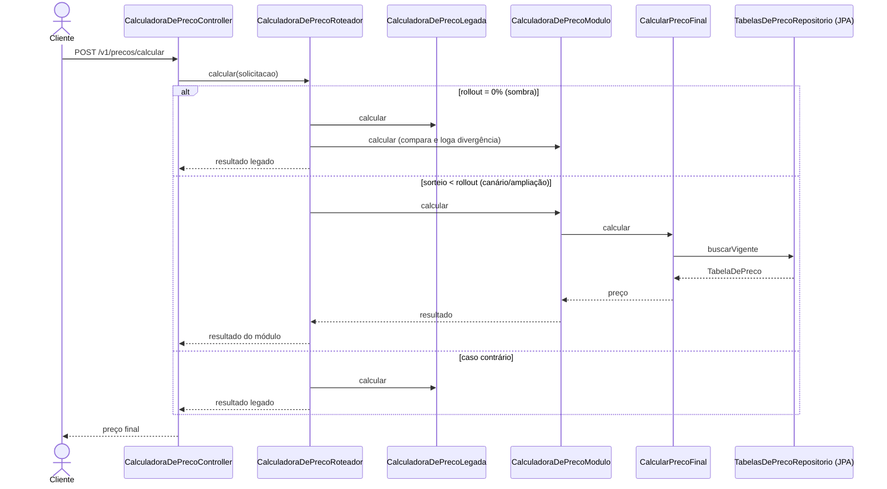
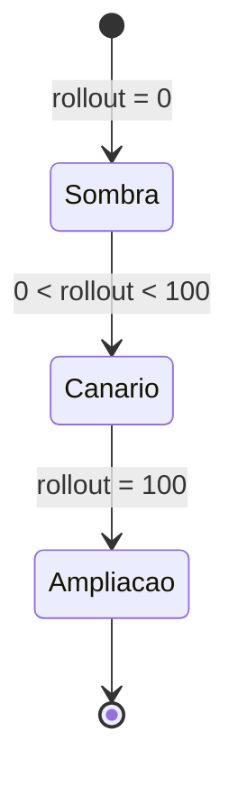

# SisVarejo — Monólito Modular, Clean Architecture e Refatoração Evolutiva

> Este README é a especificação funcional e arquitetural para implementação de uma aplicação baseada no estudo de caso da Aula 2 (Unidade 4). Ele **não contém código** — a implementação deve ser feita por outra IA/desenvolvedor a partir destas instruções.

## Stack obrigatória

- **Linguagem: Java** (17 ou 21 LTS)
- **Framework: Spring Boot 3.x**
- Build: Maven ou Gradle
- Testes de arquitetura: **ArchUnit** (obrigatório — é o cerne do exercício)
- Banco de dados: um esquema por módulo no mesmo banco (H2 ou PostgreSQL), **nunca** tabelas compartilhadas entre módulos
- Opcional: Spring Modulith pode ser usado como apoio para organizar os módulos, mas não é obrigatório — o que importa é a verificação ArchUnit das fronteiras

## Contexto de negócio

A rede Bom Preço possui 85 supermercados. Toda a operação de retaguarda (cadastro de produtos, formação de preços e promoções, estoque, compras, fiscal e fidelidade) é suportada pelo SisVarejo — historicamente um monólito com uma classe `GerenciadorDeVendas` de mais de 4.500 linhas, que calculava preços, aplicava promoções, baixava estoque, gravava registros fiscais e enviava mensagens ao programa de fidelidade, tudo junto.

## Objetivo do exercício

**Não é para reconstruir o legado.** O objetivo é construir a **arquitetura-alvo**: um **monólito modular**, com um módulo de **Preços** já estruturado segundo a **Clean Architecture**, demonstrando o processo de extração do legado via o padrão **Strangler Fig**, protegido por **testes de caracterização**.

## Estrutura de módulos obrigatória

Implementar como uma única aplicação Spring Boot (um só processo, um só deploy), organizada em pacotes por módulo, cada um dono exclusivo de suas tabelas:

- `vendas` — simula o ponto de entrada de uma venda (representa o "legado"); nunca acessa diretamente as tabelas de outros módulos
- `precos` — módulo extraído, estruturado com **Clean Architecture** (ver seção abaixo)
- `estoque` — módulo simples (CRUD), apenas para demonstrar isolamento
- `fiscal` — módulo simples (CRUD), apenas para demonstrar isolamento
- `fidelidade` — módulo simples (CRUD), apenas para demonstrar isolamento

**Regra geral:** um módulo só pode conversar com outro pela interface pública (ex. pacote `precos.api`) ou por eventos internos — nunca acessando classes internas (`precos.interno`) ou tabelas de outro módulo diretamente.

## Clean Architecture do módulo `precos`

| Camada | Elementos |
|---|---|
| Entidades (núcleo) | `Produto`, `TabelaDePreco`, `RegraDePromocao` — regras de negócio mais estáveis (ex. como descontos são acumulados) |
| Casos de uso | `CalcularPrecoFinal`, `PublicarCampanha` — orquestram as entidades, dependem apenas de **portas** (interfaces) |
| Portas (interfaces de saída) | `TabelasDePrecoRepositorio` — descreve o que o núcleo precisa do mundo externo, sem saber como |
| Adaptadores (camada externa) | implementação JPA/JDBC da porta de repositório; controller REST que atende as requisições; publicador de eventos |

**Regra da dependência (obrigatória):** o código-fonte só pode depender de fora para dentro. As entidades e casos de uso **não podem** importar classes de persistência (`jakarta.persistence`, `java.sql`) nem de frameworks web.

## Regras de fronteira a verificar com ArchUnit (obrigatórias)

Reproduzir, adaptando os nomes de pacote ao projeto:

```
1. Nenhuma classe fora do pacote precos pode acessar precos.interno
   (só pode usar precos.api)
2. Nenhuma classe do pacote precos.dominio pode depender de
   java.sql.* ou jakarta.persistence.*
```

Essas regras devem rodar como testes automatizados (`@AnalyzeClasses`) e falhar o build se violadas.

## Strangler Fig — simular a extração gradual

Criar uma interface `CalculadoraDePreco` (a "fachada") com **duas implementações**:

- `CalculadoraDePrecoLegada` — simula o cálculo antigo (pode ser uma implementação simples, propositalmente menos organizada, dentro do módulo `vendas`, representando o código pré-refatoração)
- `CalculadoraDePrecoModulo` — delega para o caso de uso `CalcularPrecoFinal` do módulo `precos` (Clean Architecture)

A fachada deve escolher qual implementação usar com base em uma configuração externa (ex. propriedade `sisvarejo.precos.rollout-percentual` ou uma feature flag simples), simulando as três fases descritas no caso: **sombra** (0% no novo módulo, mas ambos executam e os resultados são comparados/logados), **canário** (uma fração pequena usa o novo módulo) e **ampliação** (100%).

## Testes de caracterização (golden master) — obrigatórios

Criar uma suíte de testes parametrizados que executa um conjunto de combinações fixas de entrada (produto, loja, data, quantidade, fidelidade) contra **ambas** as implementações (`Legada` e `Modulo`) e verifica que os preços calculados são idênticos. Isso prova que a extração não alterou o comportamento observável.

## Endpoint mínimo exposto

| Verbo | Rota | Comportamento |
|---|---|---|
| POST | `/v1/precos/calcular` | Recebe `{ produtoId, lojaId, data, quantidade, fidelidade }` e devolve o preço final calculado via a fachada `CalculadoraDePreco` (que decide internamente qual implementação usar) |

## Critérios de aceite

- [ ] Testes ArchUnit presentes e passando, bloqueando acesso cruzado entre módulos e dependência de infraestrutura no núcleo do módulo `precos`
- [ ] Módulo `precos` segue Clean Architecture com as 4 camadas descritas (entidades, casos de uso, portas, adaptadores)
- [ ] Fachada `CalculadoraDePreco` alterna entre implementação legada e nova via configuração externa
- [ ] Suíte de testes de caracterização (golden master) comparando as duas implementações para o mesmo conjunto de entradas
- [ ] Nenhum módulo acessa diretamente as tabelas de outro módulo (verificável tanto por ArchUnit quanto por inspeção do schema)

## Execução da implementação

Requisitos: Java 17 e Maven.

```bash
mvn spring-boot:run
mvn test
```

A aplicação usa H2 em memória, com schemas separados (`precos`, `estoque`, `fiscal` e
`fidelidade`). O percentual do novo módulo pode ser definido em
`sisvarejo.precos.rollout-percentual` (0 a 100); o padrão `0` executa ambos os cálculos
em modo sombra e retorna o resultado legado.

Exemplo de requisição:

```bash
curl -X POST http://localhost:8080/v1/precos/calcular \
  -H 'Content-Type: application/json' \
  -d '{"produtoId":"PROD-001","lojaId":"LOJA-001","data":"2026-01-15","quantidade":1,"fidelidade":false}'
```

Os módulos de estoque, fiscal e fidelidade expõem CRUDs em `/v1/estoque`,
`/v1/fiscal/documentos` e `/v1/fidelidade/clientes`, respectivamente.

---

# Estado atual do projeto

O projeto já está implementado como um **monólito modular** Spring Boot (um processo, um deploy). O módulo `precos` segue Clean Architecture; `vendas` representa o legado e aplica o **Strangler Fig** por meio de um roteador que alterna entre o cálculo legado e o novo módulo conforme `sisvarejo.precos.rollout-percentual`. Estoque, fiscal e fidelidade são CRUDs simples e isolados. Os testes cobrem fronteiras (ArchUnit), caracterização (golden master), roteador e endpoint.

## Modelo C4

### Nível 1 — Contexto



### Nível 2 — Contêineres



### Nível 3 — Componentes



## Diagramas UML

### Componentes / pacotes e dependências



### Diagrama de classes (Strangler Fig e Clean Architecture)



### Diagrama de sequência — POST /v1/precos/calcular



### Evolução Strangler Fig


